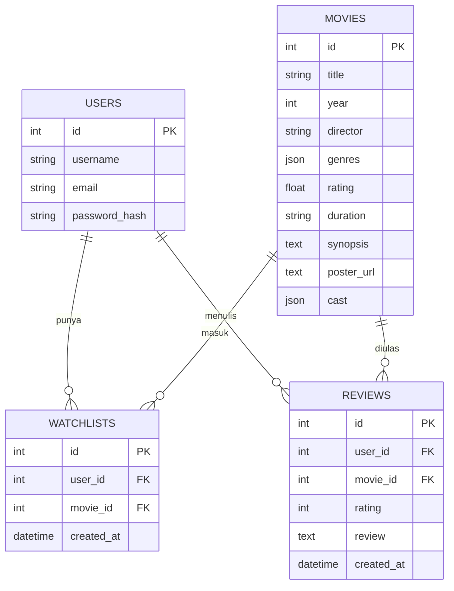

# Movie Watchlist API (FilmLog Backend)

REST API sederhana untuk aplikasi pelacak film bergaya Letterboxd/IMDb. Dibuat untuk seleksi tahap 2 GDGoC UGM (Hacker, Backend).

Fitur: akun pengguna (register/login), katalog 20 film, watchlist, riwayat tontonan + rating + review, dan rekomendasi film memakai Gemini AI yang hanya memilih dari film di database lokal.

## Teknologi

- Python 3.14, FastAPI
- SQLite + SQLAlchemy (ORM)
- bcrypt (hash password), PyJWT (JWT)
- Google Gemini API (`google-genai`)
- Swagger UI bawaan FastAPI untuk uji API

## Struktur Folder

```text
.
├── app/
│   ├── main.py          # aplikasi FastAPI, CORS, format error, seeding saat start
│   ├── config.py        # baca .env
│   ├── database.py      # koneksi SQLite
│   ├── models.py        # 4 tabel database
│   ├── schemas.py       # validasi request/response
│   ├── security.py      # hash password, JWT, cek user login
│   ├── seed.py          # isi 20 film dari data/movies.json
│   └── routers/
│       ├── auth.py      # register, login
│       ├── movies.py    # daftar & detail film
│       ├── watchlist.py # watchlist (terproteksi)
│       ├── watched.py   # watched + review (terproteksi)
│       └── recommend.py # rekomendasi Gemini
├── data/                # movies.json (20 film) dan seed.sql dari starter pack
├── frontend/            # frontend starter pack (tidak diubah)
├── .env.example
├── requirements.txt
└── README.md
```

## Database (ERD)



- Satu user bisa punya banyak baris watchlist dan banyak review.
- Satu film bisa muncul di watchlist dan review banyak user.
- `watchlists` dan `reviews` adalah tabel penghubung user dan film.
- Pasangan `(user_id, movie_id)` unik di kedua tabel: tidak ada data ganda.

## Cara Memasang

Butuh Python 3.14 (versi lain yang cukup baru biasanya juga bisa).

```bash
python -m venv .venv

# aktifkan virtual environment
#   Windows PowerShell : .venv\Scripts\Activate.ps1
#   Windows CMD        : .venv\Scripts\activate.bat
#   macOS / Linux      : source .venv/bin/activate

pip install -r requirements.txt
```

## Mengatur `.env`

1. Salin `.env.example` menjadi `.env`.
2. Isi `SECRET_KEY` dengan string acak:
   ```bash
   python -c "import secrets; print(secrets.token_hex(32))"
   ```
3. Isi `GEMINI_API_KEY` dengan API key dari https://aistudio.google.com/apikey
4. `GEMINI_MODEL` bisa diganti jika model default tidak tersedia untuk akunmu.

File `.env` tidak ikut ke GitHub (sudah ada di `.gitignore`).

## Menjalankan Backend

```bash
uvicorn app.main:app --reload
```

Server jalan di http://127.0.0.1:8000. Swagger UI: http://127.0.0.1:8000/docs

## Database Seeding

Seeding berjalan otomatis setiap server start. Film dicek lewat `id`, jadi tidak pernah terduplikasi. Untuk menjalankan manual:

```bash
python -m app.seed
```

## Menjalankan Frontend (opsional)

```bash
cd frontend
python -m http.server 3000
```

Buka http://localhost:3000. Frontend memakai API di `http://localhost:8000/api` secara default.

## Daftar Endpoint

| Method | Endpoint | Fungsi | Login? |
|---|---|---|---|
| POST | `/api/auth/register` | Buat akun baru | Tidak |
| POST | `/api/auth/login` | Login, dapat JWT | Tidak |
| GET | `/api/movies` | Daftar film. Query: `search`, `genre` | Tidak |
| GET | `/api/movies/{id}` | Detail film (404 jika tidak ada) | Tidak |
| POST | `/api/movies/recommend` | Rekomendasi film dari Gemini | Tidak |
| GET | `/api/watchlist` | Watchlist user | Ya |
| POST | `/api/watchlist` | Tambah film ke watchlist | Ya |
| DELETE | `/api/watchlist/{movieId}` | Hapus film dari watchlist | Ya |
| GET | `/api/watched` | Riwayat tontonan + rating + review | Ya |
| POST | `/api/watched` | Tambah film ditonton + rating + review | Ya |

Endpoint terproteksi butuh header `Authorization: Bearer <token>`.

Status code: 200 OK, 201 Created, 400 input tidak valid, 401 belum login/token salah, 404 tidak ditemukan, 409 data sudah ada, 502/503 masalah Gemini.
Semua error berbentuk `{"message": "..."}`.

Aturan validasi: username 3-50 karakter, email valid, password 8-72 karakter, rating 1-5, review maksimal 2000 karakter (boleh kosong).

## Contoh Penggunaan API

Contoh memakai `curl` (macOS/Linux/Git Bash). Di Windows PowerShell, lebih mudah pakai Swagger UI.

```bash
# Register
curl -X POST http://localhost:8000/api/auth/register \
  -H "Content-Type: application/json" \
  -d '{"username":"hebron","email":"hebron@example.com","password":"rahasia123"}'

# Login (salin nilai "token" dari response)
curl -X POST http://localhost:8000/api/auth/login \
  -H "Content-Type: application/json" \
  -d '{"email":"hebron@example.com","password":"rahasia123"}'

# Film Sci-Fi yang judul/sutradaranya mengandung "inception"
curl "http://localhost:8000/api/movies?genre=Sci-Fi&search=inception"

# Tambah ke watchlist
curl -X POST http://localhost:8000/api/watchlist \
  -H "Authorization: Bearer TOKEN_KAMU" -H "Content-Type: application/json" \
  -d '{"movieId":1}'

# Tandai sudah ditonton
curl -X POST http://localhost:8000/api/watched \
  -H "Authorization: Bearer TOKEN_KAMU" -H "Content-Type: application/json" \
  -d '{"movieId":1,"rating":5,"review":"Filmnya luar biasa"}'

# Rekomendasi Gemini
curl -X POST http://localhost:8000/api/movies/recommend \
  -H "Content-Type: application/json" \
  -d '{"prompt":"Saya ingin film fiksi ilmiah dengan cerita menarik"}'
# {"movie_id": 4, "reasoning": "..."}
```

Panduan pengujian lengkap dan panduan GitHub ada di `PANDUAN.md`.

## Catatan Desain

- Rekomendasi Gemini: seluruh film dikirim sebagai konteks, Gemini diminta membalas JSON `{movie_id, reasoning}`. Backend mengecek bahwa `movie_id` ada di database. Jika tidak valid, backend mencoba sekali lagi lalu membalas 502.
- `GET /api/watchlist` mengembalikan objek film langsung. `GET /api/watched` mengembalikan `id, movie_id, rating, review, created_at, movie`.
- Satu user hanya bisa punya satu review per film (duplikat dibalas 409).
